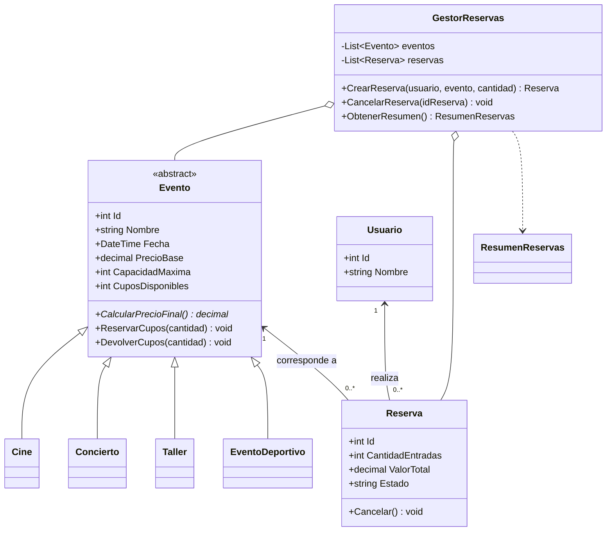

# PLANAZO-POO-CSharp

Aplicación de consola desarrollada en C# y .NET para consultar eventos, reservar entradas, controlar cupos, cancelar reservas y consultar un resumen de reservas activas.

## Requisitos

- .NET 8 SDK (o una versión compatible que permita compilar el proyecto).
- Git, para publicar el repositorio en GitHub.

## Cómo ejecutar

1. Descarga o clona el repositorio.
2. Abre una terminal en la carpeta que contiene `PLANAZO-POO-CSharp.csproj`.
3. Ejecuta:

```bash
dotnet run
```

## Funcionalidades

- Lista eventos y permite consultar un evento por identificador.
- Inicia con dos películas, dos conciertos, dos talleres y un evento deportivo.
- Calcula el precio final de cada tipo de evento.
- Registra reservas y descuenta cupos.
- Valida que la cantidad de entradas sea positiva y no supere los cupos.
- Permite consultar y cancelar reservas; al cancelar devuelve los cupos.
- Impide cancelar dos veces una misma reserva.
- Muestra un resumen de reservas activas.
- Permite consultar las reservas de un usuario.
- Controla errores de entrada y operaciones no permitidas sin cerrar intencionalmente el menú.

## Organización y relación de clases

- `Evento.cs`: clase abstracta con los datos y operaciones comunes a los eventos.
- `Cine.cs`, `Concierto.cs`, `Taller.cs` y `EventoDeportivo.cs`: clases derivadas que implementan `CalcularPrecioFinal()`.
- `Usuario.cs`: representa a una persona que realiza reservas.
- `Reserva.cs`: relaciona un usuario con un evento y conserva cantidad, total y estado.
- `GestorReservas.cs`: administra listas de eventos y reservas, y aplica las reglas de reserva y cancelación.
- `ResumenReservas.cs`: agrupa los datos calculados del resumen.
- `Program.cs`: presenta el menú y recibe los datos del usuario.

## Conceptos de POO

- **Abstracción:** `Evento` es abstracta porque representa características comunes, pero no define por sí sola el precio específico de cada categoría.
- **Herencia:** `Cine`, `Concierto`, `Taller` y `EventoDeportivo` heredan de `Evento`.
- **Polimorfismo:** el gestor trabaja con elementos de tipo `Evento`, pero cada objeto ejecuta su propia versión de `CalcularPrecioFinal()`.
- **Encapsulamiento:** los cupos se modifican mediante `ReservarCupos()` y `DevolverCupos()`. El estado de una reserva cambia con `Cancelar()`, que impide cancelar dos veces.
- **Constructores:** inicializan eventos, usuarios y reservas validando sus datos.
- **Colecciones:** `List<Evento>` y `List<Reserva>` almacenan los datos durante la ejecución.
- **Excepciones:** se lanzan excepciones cuando hay cantidades inválidas, identificadores inexistentes o falta de cupos; el menú captura los errores para continuar.
- **Asociación/composición del modelo:** `Reserva` mantiene referencias a un `Usuario` y a un `Evento`; `GestorReservas` administra las colecciones.

## Reglas de precios

- Cine: precio base sin cambios.
- Concierto: precio base más 15 %.
- Taller: descuento del 10 % sobre el precio base.
- Evento deportivo: precio base más 5 % (reto adicional).

Ejemplo: concierto con precio base de `$50.000` = `$57.500`.

## Pregunta de sustentación

**¿Por qué se utilizó una clase abstracta `Evento`?**

Se utilizó `Evento` para reunir los datos que comparten todos los eventos, como el nombre, la fecha, el precio y los cupos. Así no es necesario repetir esos atributos en cada clase. Además, `CalcularPrecioFinal()` es abstracto, por lo que cada tipo implementa su regla: `Cine` devuelve el precio base, `Concierto` suma el 15 % y `Taller` descuenta el 10 %. Si se agrega un nuevo tipo, como `EventoDeportivo`, solo se crea otra clase derivada que implementa el cálculo, sin cambiar los cálculos de las clases anteriores.

## Casos de prueba para demostrar en consola

1. Crear una reserva válida y verificar que bajen los cupos.
2. Intentar reservar más entradas de las disponibles.
3. Intentar reservar `-1` o `0` entradas.
4. Cancelar una reserva y comprobar que se recuperen los cupos.
5. Intentar cancelar de nuevo la misma reserva.
6. Consultar un identificador de evento inexistente.
7. Comprobar precios: concierto de `$50.000` = `$57.500`; taller de `$40.000` = `$36.000`; cine de `$18.000` = `$18.000`.
8. Crear reservas para un usuario y consultar sus reservas.
9. Consultar el resumen después de crear y cancelar reservas.

## Capturas de pantalla

Guarda las capturas reales de tus pruebas dentro de la carpeta `Capturas/`. Cuando las hayas añadido, puedes enlazarlas aquí, por ejemplo:

```markdown


```

No dejes enlaces a capturas que todavía no hayas creado.

## Diagrama UML



## Publicar en GitHub

1. Crea un repositorio público llamado `PLANAZO-POO-CSharp`.
2. Abre la terminal en la carpeta del proyecto.
3. Ejecuta los comandos, reemplazando `TU-USUARIO` por tu usuario real de GitHub:

```bash
git init
git add .
git commit -m "Desarrollo inicial de PLANAZO"
git branch -M main
git remote add origin https://github.com/TU-USUARIO/PLANAZO-POO-CSharp.git
git push -u origin main
```

Si GitHub creó un README automáticamente al crear el repositorio, puede ser necesario sincronizar primero el repositorio remoto antes de subir los archivos.
