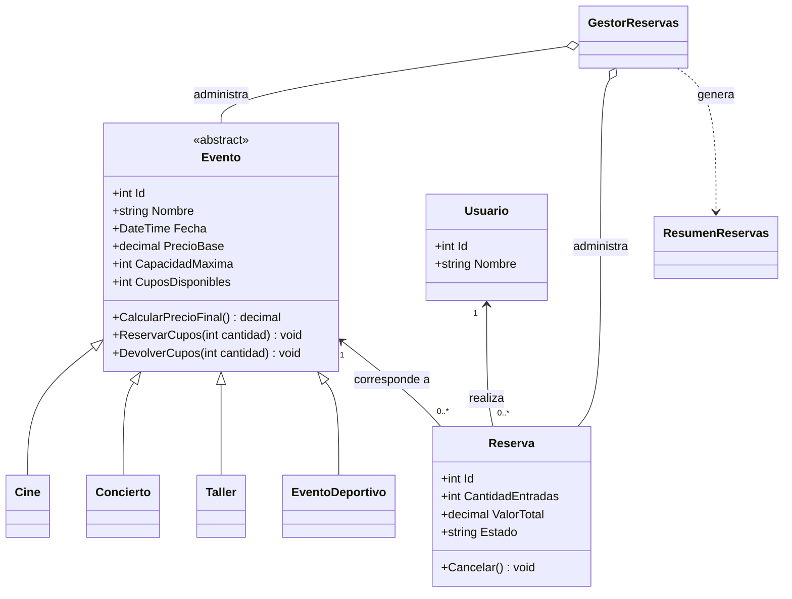

# PLANAZO-POO-CSharp 🎟️

## 1. Descripción del proyecto

PLANAZO es una aplicación de consola desarrollada en C# y .NET que permite administrar eventos de entretenimiento, como películas, conciertos, talleres y eventos deportivos.

El sistema permite consultar los eventos registrados, conocer sus precios y cupos disponibles, realizar reservas de entradas, cancelar reservas y consultar un resumen de las reservas activas.

Este proyecto se desarrolla como parte del parcial de Programación Orientada a Objetos, con el objetivo de aplicar conceptos como clases, objetos, encapsulamiento, abstracción, herencia y polimorfismo.

## 2. Objetivos

- Desarrollar una aplicación funcional utilizando C# y .NET.
- Aplicar los principios fundamentales de la Programación Orientada a Objetos.
- Controlar la disponibilidad de entradas para cada evento.
- Validar las operaciones para evitar errores en las reservas.
- Organizar el código en diferentes clases y archivos.
- Utilizar GitHub para publicar y documentar el proyecto.

## 3. Tecnologías utilizadas

- **Lenguaje:** C#
- **Plataforma:** .NET 8
- **Tipo de aplicación:** Consola
- **Control de versiones:** Git y GitHub
- **Colecciones:** `List<T>`

## 4. Funcionalidades implementadas

La aplicación cuenta con las siguientes opciones:

1. Ver eventos disponibles.
2. Consultar un evento por su identificador.
3. Reservar entradas.
4. Ver las reservas realizadas.
5. Cancelar una reserva.
6. Consultar el resumen de reservas activas.
7. Consultar las reservas asociadas a un usuario.
8. Salir del programa.

También incluye validaciones para impedir cantidades de entradas negativas o iguales a cero, reservas superiores a los cupos disponibles y cancelaciones repetidas.

Cuando se confirma una reserva, los cupos disponibles disminuyen. Cuando se cancela una reserva activa, los cupos correspondientes se devuelven.

## 5. Tipos de eventos

El sistema comienza con siete eventos registrados: dos películas, dos conciertos, dos talleres y un evento deportivo.

| Tipo de evento   | Regla de cálculo                |
| ---------------- | ------------------------------- |
| Cine             | Mantiene el precio base.        |
| Concierto        | Aumenta el precio base un 15 %. |
| Taller           | Aplica un descuento del 10 %.   |
| Evento deportivo | Aumenta el precio base un 5 %.  |

**Ejemplo de cálculo:**

Un concierto con precio base de $50.000 tiene un precio final de $57.500.

## 6. Organización de los archivos

```text
PLANAZO-POO-CSharp/
├── Program.cs
├── Modelos/
│   ├── Evento.cs
│   ├── Cine.cs
│   ├── Concierto.cs
│   ├── Taller.cs
│   ├── EventoDeportivo.cs
│   ├── Reserva.cs
│   └── Usuario.cs
├── Servicios/
│   ├── GestorReservas.cs
│   └── ResumenReservas.cs
├── Capturas/
├── README.md
├── .gitignore
└── PLANAZO-POO-CSharp.csproj
```

## 7. Explicación de las clases

### Evento

Es una clase abstracta que contiene las características comunes de los eventos: identificador, nombre, fecha, precio base, capacidad máxima y cupos disponibles.

También define el método abstracto `CalcularPrecioFinal()`, que debe ser implementado por cada tipo de evento.

### Cine

Hereda de `Evento` y mantiene el precio base sin modificaciones.

### Concierto

Hereda de `Evento` y aumenta el precio base en un 15 %.

### Taller

Hereda de `Evento` y aplica un descuento del 10 % al precio base.

### EventoDeportivo

Es una clase adicional que hereda de `Evento` y aumenta el precio base en un 5 %. Se implementa como reto adicional.

### Usuario

Representa a una persona que realiza reservas. Contiene un identificador y su nombre.

### Reserva

Relaciona un usuario con un evento. Almacena el identificador de la reserva, la cantidad de entradas, el valor total y el estado.

Además, permite cancelar una reserva y evita que una reserva cancelada vuelva a cancelarse.

### GestorReservas

Administra las listas de eventos y reservas. Se encarga de buscar eventos, registrar reservas, cancelar reservas, consultar las reservas de un usuario y calcular el resumen.

### ResumenReservas

Contiene la cantidad de reservas activas, el número total de entradas reservadas y el valor total correspondiente a las reservas activas.

### Program

Contiene el menú principal y permite que el usuario interactúe con el sistema mediante la consola. La lógica de los eventos y las reservas se encuentra separada en sus respectivas clases.

## 8. Aplicación de los principios de POO

### Encapsulamiento

Se protegen los datos mediante propiedades con acceso controlado. Por ejemplo, los cupos disponibles no se modifican directamente desde el menú, sino mediante los métodos `ReservarCupos()` y `DevolverCupos()`.

### Abstracción

La clase `Evento` representa las características comunes de todos los eventos. Es abstracta porque no define una única forma de calcular el precio final para todas las categorías.

### Herencia

Las clases `Cine`, `Concierto`, `Taller` y `EventoDeportivo` heredan de `Evento`, reutilizando sus atributos y métodos.

### Polimorfismo

Cada tipo de evento implementa su propia versión de `CalcularPrecioFinal()`. Así, el sistema puede trabajar con una colección de tipo `List<Evento>` y obtener el cálculo correspondiente a cada objeto.

### Constructores

Los constructores inicializan los objetos y validan los datos necesarios para crearlos correctamente.

### Colecciones

Se utiliza `List<Evento>` para almacenar los eventos y `List<Reserva>` para almacenar las reservas realizadas.

### Excepciones

Se utilizan excepciones para controlar situaciones como cantidades inválidas, eventos inexistentes, reservas sin suficientes cupos y cancelaciones repetidas. El menú captura los errores para evitar que una operación incorrecta cierre inesperadamente la aplicación.

### Asociaciones entre clases

Una reserva se relaciona con un usuario y un evento. El gestor administra los eventos y las reservas, mientras que el resumen reúne los resultados de las reservas activas.

## 9. Instrucciones para ejecutar el proyecto

### Requisitos previos

Es necesario tener instalado el SDK de .NET 8 o una versión compatible con el proyecto.

### Pasos para ejecutar

1. Descargar o clonar el repositorio.
2. Abrir una terminal en la carpeta raíz del proyecto, donde se encuentra el archivo `.csproj`.
3. Ejecutar el siguiente comando:

```bash
dotnet run
```

4. Esperar a que se compile y se inicie el menú.
5. Seleccionar una opción e ingresar los datos solicitados.

## 10. Casos de prueba

Para comprobar el funcionamiento del programa, se deben realizar las siguientes pruebas:

| N.º | Prueba                                     | Resultado esperado                                    |
| --- | ------------------------------------------ | ----------------------------------------------------- |
| 1   | Registrar una reserva válida.              | La reserva queda activa y disminuyen los cupos.       |
| 2   | Reservar más entradas que las disponibles. | El sistema rechaza la operación.                      |
| 3   | Ingresar una cantidad negativa.            | El sistema muestra un mensaje de error.               |
| 4   | Ingresar cero entradas.                    | El sistema rechaza la reserva.                        |
| 5   | Cancelar una reserva activa.               | La reserva cambia de estado y se devuelven los cupos. |
| 6   | Cancelar dos veces la misma reserva.       | La segunda cancelación es rechazada.                  |
| 7   | Consultar un evento inexistente.           | Se informa que el evento no existe.                   |
| 8   | Verificar los precios finales.             | Cada evento aplica su regla de precio.                |
| 9   | Consultar el resumen.                      | Se muestran los datos de las reservas activas.        |
| 10  | Consultar las reservas de un usuario.      | Se muestran las reservas asociadas a ese usuario.     |

### Ejemplos de cálculo de precios

- Cine: $18.000 → $18.000.
- Concierto: $50.000 → $57.500.
- Taller: $40.000 → $36.000.
- Evento deportivo: $30.000 → $31.500.

## 11. Pregunta de sustentación

**¿Por qué se utilizó una clase abstracta `Evento` en lugar de crear clases completamente independientes para Cine, Concierto y Taller? ¿Qué ventajas tiene esta decisión cuando necesitamos agregar un nuevo tipo de evento?**

Se utilizó una clase abstracta llamada `Evento` porque todos los eventos tienen características en común, como el nombre, la fecha, el precio base y los cupos disponibles. De esta manera, no es necesario repetir los mismos atributos y métodos en cada clase.

Además, la clase define el método `CalcularPrecioFinal()`, que cada tipo de evento implementa según sus propias reglas. Por ejemplo, `Cine` conserva el precio base, `Concierto` aumenta el precio un 15 % y `Taller` aplica un descuento del 10 %.

Si necesitamos agregar otro tipo de evento, podemos crear una nueva clase que herede de `Evento` e implemente su cálculo de precio, sin tener que modificar las clases existentes. Esto facilita la reutilización del código, el mantenimiento y la ampliación del sistema.

## 12. Diagrama de clases UML

El siguiente diagrama representa las principales clases y sus relaciones:



## 13. Evidencias de funcionamiento

En la carpeta `Capturas/` se deben agregar capturas reales tomadas durante la ejecución del programa.

Se recomienda incluir:

- `menu-principal.png`: menú inicial.
- `eventos-disponibles.png`: listado de eventos.
- `reserva-valida.png`: registro de una reserva correcta.
- `error-cupos.png`: intento de reservar más entradas que las disponibles.
- `cancelacion.png`: cancelación y devolución de cupos.
- `cancelacion-repetida.png`: intento de cancelar una reserva dos veces.
- `resumen.png`: resumen de las reservas activas.

Las capturas deben corresponder a pruebas realizadas realmente. Después de agregarlas, se pueden enlazar en esta sección.

## 14. Conclusión

El desarrollo de PLANAZO permite aplicar los conceptos fundamentales de la Programación Orientada a Objetos mediante un sistema de eventos y reservas. La separación de responsabilidades facilita la comprensión del código y permite agregar nuevos tipos de eventos sin tener que reconstruir todo el programa.

El proyecto también demuestra la importancia de validar los datos, controlar los cupos y manejar los errores para ofrecer un funcionamiento más confiable.

## 15. Autor

steven andres agamaez orozco

